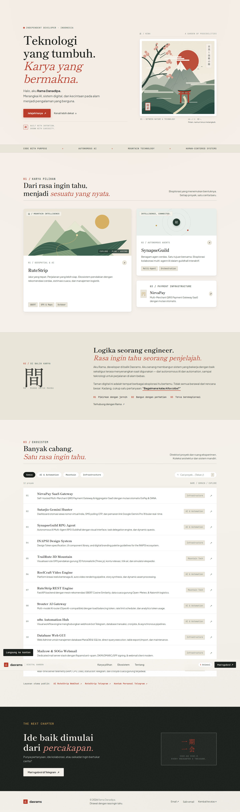
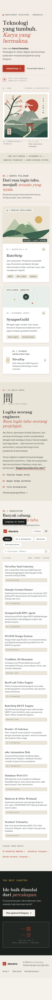

# 庭 · DASRAMS DIGITAL GARDEN (dasrams.biz.id)

<div align="center">

```
   ┌─────────────────────────────────────────────────────────────┐
   │   自然と技術の間  ·  BETWEEN NATURE & COGNITIVE CODE        │
   │                                                             │
   │       山            雲            日            庭          │
   │    Mountain       Clouds         Sun          Garden        │
   └─────────────────────────────────────────────────────────────┘
```

# ⚡ Rama Danadipa — Digital Garden & Cloud Ecosystem
### Official Japanese Editorial Redesign of [https://dasrams.biz.id](https://dasrams.biz.id)

[](https://dasrams.biz.id)
[](https://dasrams.biz.id)
[](https://dasrams.biz.id)
[](https://dasrams.biz.id)

<p align="center">
  <b>Teknologi yang tumbuh. Karya yang bermakna.</b><br>
  <i>A personal cyber sanctuary exploring autonomous AI agents, geospatial mountain technologies, and resilient infrastructure.</i>
</p>

[🌐 Live Production Portal](https://dasrams.biz.id) • [💬 Telegram Official](https://t.me/dasrams) • [🏔️ RuteStrip Project](https://rutestrip.web.id)

---

</div>

## ⛩️ Design Philosophy · 理念

Website ini dirancang ulang dengan mengadopsi filosofi desain **Japanese Editorial Aesthetic & Digital Garden**:

1. **間 (Ma) — The Power of Negative Space**
   Setiap kartu, heading, dan direktori tidak dipadatkan dalam dinding kartu seragam (*AI slop card walls*), melainkan diberi ruang bernapas alami yang membimbing mata pembaca secara tenang dan terarah.

2. **和紙 (Washi) & 墨 (Sumi Ink)**
   Permukaan kanvas menggunakan tekstur serat mikro kertas hangat (*Ivory Washi* `#F5F2EB`) dipadukan dengan tipografi tinta pekat (*Sumi Ink* `#1C201D`), meninggalkan tren template neon gelap yang klise.

3. **自然と技術 (Nature & Technology)**
   Pertemuan antara algoritma cerdas (SBERT, Autonomous Multi-Agents) dengan keindahan alam (kontur rute GPX pendakian, topografi gunung, dan gerbang torii).

4. **一期一会 (Ichi-go Ichi-e)**
   Setiap interaksi pengguna diperlakukan berharga — dilengkapi kontrol gerakan halus (*motion toggle*), aksesibilitas keyboard lengkap, serta performa super cepat tanpa runtime framework berat.

---

## 🎨 Traditional Color Harmony · 色彩の調和

Sistem token warna dikalibrasi secara ketat berdasarkan palet tradisional Jepang:

| Token | Warna | Hex | Filosofi & Penggunaan |
|---|---|---|---|
| `--canvas-base` | **Washi Ivory** | `#F5F2EB` | Latar belakang dasar kertas tradisional berserat halus |
| `--ink-primary` | **Sumi Ink** | `#1C201D` | Tinta kaligrafi pekat untuk teks judul dan batas kuat |
| `--ink-secondary` | **Muted Ink** | `#4A544D` | Tinta pendukung untuk narasi, deskripsi, dan rincian |
| `--akane-vermilion` | **Akane Red** | `#B93C2A` | Matahari terbit, stempel inkan, dan penanda aksi primer |
| `--matsu-pine` | **Matsu Pine** | `#263C33` | Hijau pinus pegunungan untuk modul geospatial & kecerdasan |
| `--kin-gold` | **Kin Gold** | `#C29B4F` | Aksen emas antik untuk modul pembayaran dan lambang bernilai |

---

## 🌸 Motion System & Animation · 動きの美学

Sistem animasi dibangun menggunakan **Pure CSS GPU-accelerated Keyframes** yang menghormati kenyamanan visual:

- **Guguran Kelopak Sakura (`petalFall1`, `petalFall2`, `petalFall3`)**: Tiga lintasan kurva sinusoidal 3D dengan rotasi lembut menuruni viewport.
- **Awan Tradisional Mengambang (`cloud-one`, `cloud-two`)**: Gerakan horizontal siklik bolak-balik dengan kecepatan bertingkat (*slow & fast parallax*).
- **Denyut Matahari Akane (`sunGlow`)**: Animasi bernapas halus dengan skala `1.03` dan osilasi opasitas.
- **Orbit AI Multi-Agent (`orbitRotate`)**: Rotasi orbit melingkar yang menggambarkan node kolaboratif SynapseGuild.
- **Saklar Gerakan Cerdas (`#motion-toggle`)**: Tombol terintegrasi di navbar untuk menjeda/mengaktifkan seluruh animasi, tersimpan otomatis di `localStorage` dan menghormati preferensi OS `prefers-reduced-motion`.

---

## 📸 Visual Showcase · 視覚的プレビュー

### 🖥️ Desktop Experience
<p align="center">
  
</p>

### 📱 Fluid Mobile Experience
<p align="center">
  
</p>

---

## 📁 Repository Structure · 構成

```text
dasrams-redesign/
├── index.html              # Core editorial markup, semantic landmarks & SVG landscape
├── assets/
│   ├── garden.css          # Bespoke Japanese typography, layout tokens & keyframes
│   ├── garden.js           # Client controller: motion toggle, filters, search, toast
│   └── mark.svg            # Hanko seal vector favicon
├── docs/
│   └── preview/            # Headless browser verification captures
│       ├── desktop.png
│       └── mobile.png
└── README.md               # Visual presentation and architecture guide
```

---

## 🌐 12 Ecosystem Nodes & Subdomains · 生態系

| Domain | Service | Stack | Kategori |
|---|---|---|---|
| `dasrams.biz.id` | Main Digital Garden & Portfolio | Pure HTML/CSS, Shippori Mincho, SVG | **Portal** |
| `rutestrip.web.id` | RuteStrip Official Hiking Portal | FastAPI, SBERT, Open-Meteo, GPX | **Mountain** |
| `airutestrip.web.id` | AI RuteStrip WebChat Assistant | SBERT Vector RecSys, Neural Chat | **AI & Mountain** |
| `nirvapay.dasrams.biz.id` | NirvaPay Multi-Merchant QRIS | GoPay & DANA Mutation Aggregator SaaS | **Infra** |
| `rpg.dasrams.biz.id` | SynapseGuild Autonomous AI Guildhall | Multi-Agent RPG Engine, WebSockets | **AI** |
| `sutarjio.dasrams.biz.id` | Sutarjio Gemini Hunter | SMS OTP Poller, Automation Dashboard | **AI** |
| `trail.dasrams.biz.id` | TrailRute 3D Mountain Expedition | Three.js, WebGL 3D Topography | **Mountain** |
| `inapsi.dasrams.biz.id` | INAPSI Design Tokens & System | UI Specification, Design Tokens | **Infra** |
| `reelcraft.dasrams.biz.id`| ReelCraft Video Generation Engine | AI Story & Dynamic Video Studio | **AI** |
| `9router.dasrams.biz.id`  | 9router AI Model Load Balancer | OpenAI-Compatible Gateway | **AI** |
| `n8n.dasrams.biz.id`      | n8n Webhook & Workflow Engine | Low-Code Automation Pipelines | **Infra** |
| `monitor.dasrams.biz.id`  | Sentinel Telemetry & Watchdog | FastAPI, psutil, Live Probes | **Infra** |

---

## ⌨️ Micro-Interactions & Ergonomics · 操作性

- **Pencarian Cepat**: Tekan tombol `/` di keyboard kapan saja untuk langsung memfokuskan kotak pencarian proyek.
- **Escape Key Navigation**: Menekan `Esc` membersihkan pencarian atau menutup menu mobile secara instan.
- **1-Click Salin Kontak**: Tombol *Salin email* di footer menyalin `admin@dasrams.biz.id` dengan umpan balik toast notifikasi pegas (*spring toast*).
- **Zero Framework Overhead**: Bebas dari kompilasi runtime client-side seperti Tailwind CDN atau bundle React yang berat, menghasilkan skor performa Core Web Vitals optimal.

---

## 🚀 Deployment & Serving

Disajikan secara native menggunakan server web berkinerja tinggi Nginx:

```nginx
server {
    listen 80;
    listen 443 ssl http2;
    server_name dasrams.biz.id www.dasrams.biz.id;

    ssl_certificate /etc/ssl/certs/dasrams.biz.id.crt;
    ssl_certificate_key /etc/ssl/private/dasrams.biz.id.key;

    root /www/wwwroot/dasrams_portal;
    index index.html;

    # Gzip & Compression
    gzip on;
    gzip_types text/plain text/css application/javascript application/json image/svg+xml;

    location / {
        try_files $uri $uri/ /index.html;
    }

    location ~* \.(?:css|js|svg|png|jpg|webp)$ {
        expires 30d;
        add_header Cache-Control "public, no-transform";
    }
}
```

---

## 🛡️ License & Credits

Hak Cipta © 2026 **Rama Danadipa (@dasrams)**.  
Didesain dan dirawat dengan perhatian penuh sebagai bagian dari ekosistem cloud mandiri.
